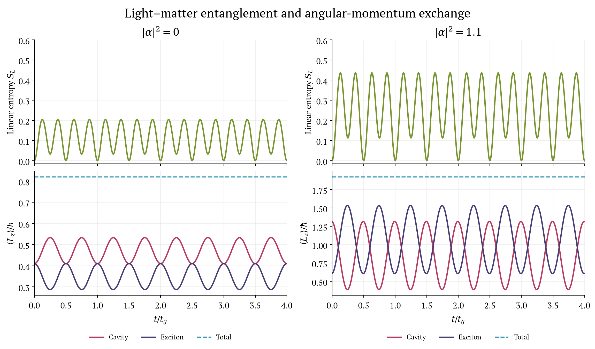
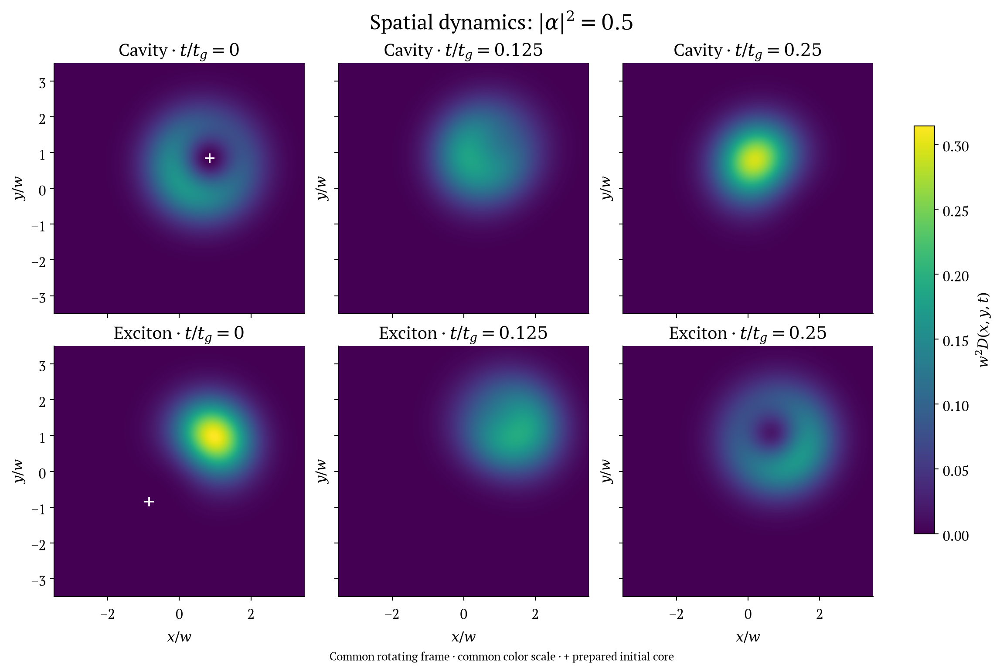
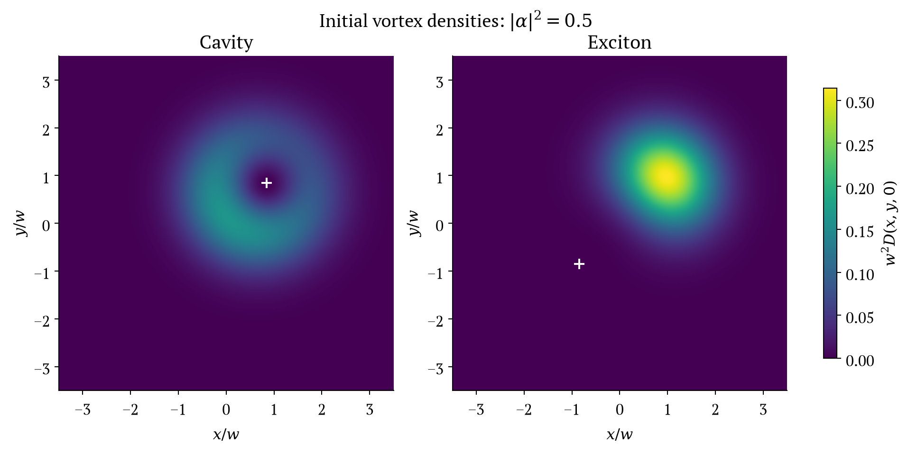
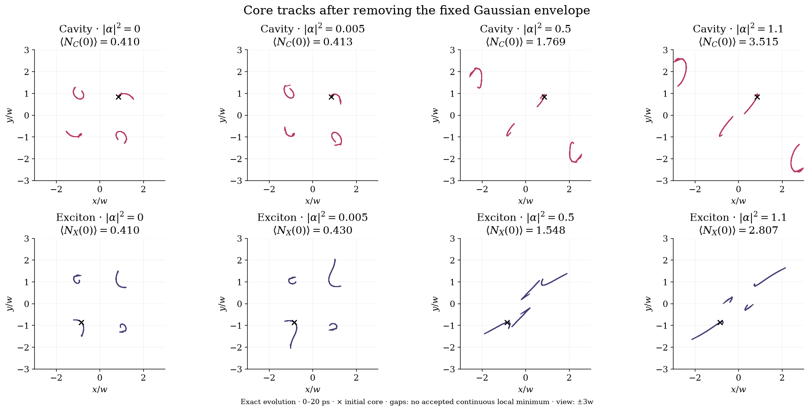
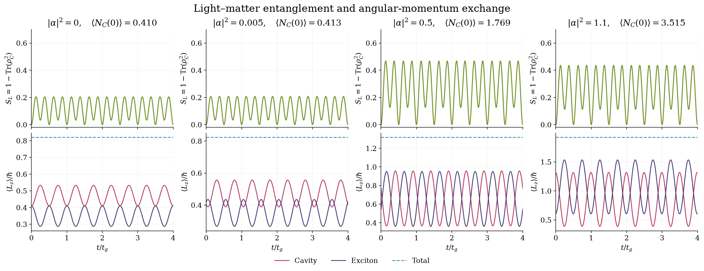
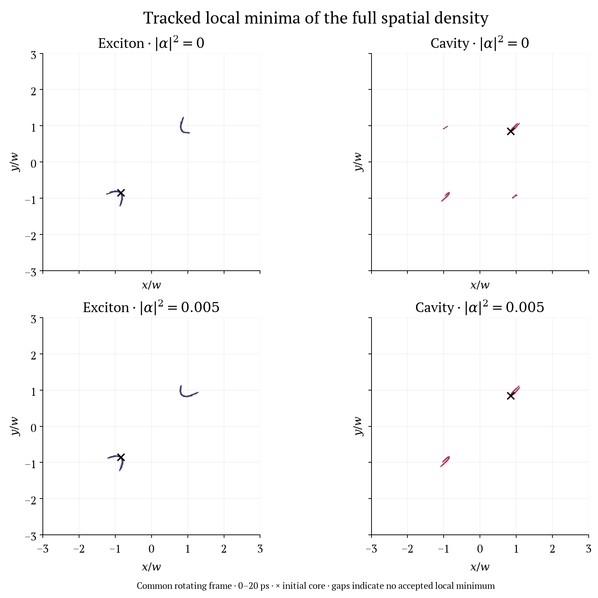

# Coherence in Polaritonic Vortices

Quantum dynamics of coupled cavity and exciton oscillators, starting from vortex-modified coherent states.

Reference: J. P. Restrepo Cuartas et al., *Dynamics of a quantum polariton vortex: Low-excitation scenario*, Physical Review B **110**, 155433 (2024), [doi:10.1103/PhysRevB.110.155433](https://doi.org/10.1103/PhysRevB.110.155433).

## Model and initial preparation

We retain the paper's number-conserving quadratic Hamiltonian:
```text
H/hbar = sum_j [ omega_C a_j^dagger a_j + omega_X b_j^dagger b_j
                + Omega (a_j^dagger b_j + b_j^dagger a_j) ], j=x,y.
```
The effective energies follow Eq. (2), Ecal_k = E_k - hbar^2/(4 m_k w^2).
Energies are in meV, times in ps and spatial coordinates in micrometres.

The paper uses a Gaussian ground-state envelope multiplied by a vortex factor. Here each envelope can be a coherent state:
```text
psi_k(x,y,0) = N_k [(x-x_k) + i(y-y_k)] phi_(alpha,alpha)(x,y).
```
The full initial state is a product of the two normalized vortex states. Setting alpha=0 recovers the paper's initial-state form. The parameter |alpha|^2 refers to EACH Cartesian coherent background before applying the vortex factor; it is not the mean photon number of the final vortex state.

No dissipation or exciton-exciton interactions are added.

## Corrected evolution and reference frame

The numerical solver evolves a normalized Fock-space state under the static Hamiltonian in a **common rotating frame**, at (Ecal_C+Ecal_X)/(2 hbar):
```text
H_rot/hbar = Delta/2 (N_C-N_X)
            + Omega sum_j (a_j^dagger b_j + b_j^dagger a_j).
Delta = (Ecal_C-Ecal_X)/hbar.
```
All generated spatial figures refer to this common frame. They are not laboratory-frame positions or coordinate densities reconstructed directly from interaction-picture coefficients. In the conventional interaction picture a_j^dagger b_j has phase exp(+i Delta t).

The numerical solver remains available for cross-checks. It reports the probability retained by the initial Fock projection, normalizes by default, and warns about appreciable missing norm. Normalization by itself does not establish dynamical cutoff convergence.

### Exact solution for the current initial-state family

The figure generator uses `ExactCoherentEvolution`. Write the initial state as a product of local displacement operators acting on a seed. Each vortex-modified coherent state has at most one excitation in its displaced seed, so the bipartite seed has total excitation at most two. The quadratic number-conserving Hamiltonian preserves this total seed excitation exactly.

The method evolves:
1. The four coherent amplitudes with the single-particle unitary.
2. The small seed with the Hamiltonian matrix exponential.
3. Observables with the displacements restored where necessary.

The full physical state still has infinitely many undisplaced Fock components. The local cutoff of two used for the **displaced seed** is exact for this family; it is not the earlier, incorrect cutoff of one per undisplaced subsystem. No coherent-state occupation truncation is used for the reference plots.

## Entanglement and angular momentum



The comparison uses |alpha|^2=0 and 1.1, with all other preparation parameters fixed. Linear entropy is
```text
S_L = 1 - Tr[(rho/Tr rho)^2].
```
It vanishes initially for the product preparation. Because the full state remains pure, it measures light-matter entanglement. Local coherent displacements leave the Schmidt spectrum unchanged, so entropy can be evaluated on the exact seed.

Angular momentum includes both the seed and the coherent displacement. It is plotted in units of hbar; cavity and exciton components exchange angular momentum, while their sum is conserved. The corrected observables show periodic dynamics. Earlier irregular curves were affected by insufficient truncation and should not be used as evidence of irreversible behavior.

We retain the earlier time convention t_g=2*pi/sqrt(Omega^2+Delta^2/4), explicitly defined here. It is a reference scale, not a claim that it is the shortest observable recurrence period.

## Spatial reconstruction



Reduced spatial densities are reconstructed from normalized Hermite-Gaussian oscillator functions. In the exact displaced representation the spatial density is the seed density evaluated at r-mu_k(t), where mu_k=sqrt(2)*w*Re alpha_k(t). These figures use a common color scale and show w^2 D(x,y,t).



An initial vortex zero can lie in a low-intensity tail; the exciton density may therefore look predominantly Gaussian in a linear color scale even though its prepared zero is present.

## Density-minimum tracking

### Paper-inspired core comparison with all excitation manifolds retained

The additional scan in [`results/paper_core`](results/paper_core) uses the paper's **fixed-Gaussian removal prescription**, extended to the exact state rather than restricting each subsystem to its first excitation manifold:

$$
F_k(\mathbf r,t)=w^2 e^{|\mathbf r|^2/w^2}D_k(\mathbf r,t).
$$

Writing $\mathbf R=\mathbf r/w$, $\boldsymbol\mu_k=\sqrt2\,\mathrm{Re}\,\boldsymbol\alpha_k(t)$ and $\mathbf z=\mathbf R-\boldsymbol\mu_k$, the exact reduced density is $w^2D_k=e^{-|\mathbf z|^2}P_k(\mathbf z,t)$. Therefore

$$
F_k=e^{2\boldsymbol\mu_k\cdot\mathbf z+|\boldsymbol\mu_k|^2}P_k(\mathbf z,t),
\qquad \nabla P_k+2\boldsymbol\mu_k P_k=0.
$$

For this initial-state family $P_k$ is at most quartic. At nonzero coherent background the factor after removing the **fixed** Gaussian is exponential times quartic; minimizing only the quartic would remove the evolving coherent Gaussian instead and define a different prescription. At alpha=0 the two envelope choices coincide. No quadratic Taylor approximation is made.

The physical evolution retains all undisplaced coherent-state excitation manifolds through the exact displaced-seed representation. The seed's total-excitation bound of two is exact for this preparation and does not discard the higher physical coherent occupations. In particular, two excitations in one subsystem after exchange are retained even at alpha=0.

`paper_core.track_paper_core` locates local minima with a positive Hessian and small gradient residual, using multiple initial guesses and continuity tracking. Because the exponential factor can approach zero at infinity, this is a **local-minimum** prescription, not an unconstrained global minimization of F. Gaps and branch breaks indicate no accepted continuous track under the stated numerical criteria; they do not establish the absence of every minimum. This prescription is not a certificate of a phase singularity in a mixed reduced state, and the figures are not claimed to reproduce a particular panel of the paper.





The comparisons use $|\alpha|^2=0,0.005,0.5,1.1$ per Cartesian background, with other parameters held fixed. This parameter is **not** the physical mean photon number after vortex imprinting; initial physical occupations are reported in `results/paper_core/validation.json`. All trajectory panels show the same 0–20 ps interval and common rotating frame, with a ±3w viewing window. The numerical search extends to radius 12w, and un-clipped accepted coordinates are preserved in CSV/NPZ files. Entropy and angular momentum use the same preparations and exact dynamics; their time interval is 0–4t_g. The definition of core position does not alter either observable.

```bash
python examples/generate_paper_core_comparison.py
```

PNG/PDF figures, CSV/NPZ samples, and a validation report are written to `results/paper_core`. Use `--reuse` only to redraw existing samples with unchanged settings. Individual low/higher-background trajectory figures and a larger alpha2=0 versus 1.1 entropy/OAM comparison are also supplied.

For the default preparation, the actual initial occupations are:

| Coherent background $\lvert\alpha\rvert^2$ | $\langle N_C(0)\rangle$ | $\langle N_X(0)\rangle$ |
|---|---:|---:|
| 0 | 0.409836 | 0.409836 |
| 0.005 | 0.412715 | 0.430074 |
| 0.5 | 1.769231 | 1.547945 |
| 1.1 | 3.514645 | 2.807320 |

Figure titles distinguish the background parameter from these physical occupations. Both CSV and compressed NPZ samples are generated locally; compressed NPZ data are committed alongside the figures.

### Full-density minima (a different prescription)



The new tracker finds stationary points of the **full density including its Gaussian envelope**, checks the gradient and positive Hessian, and tracks local minima within radius 3w. Initial points recover the prescribed vortex cores. Multiple starting guesses and a continuity check are used. Missing or rejected minima produce NaN gaps.

These curves are **accepted local density-minimum tracks**, not proof of persistent topological vortices in mixed reduced states. Gaps mean that the stated numerical acceptance criteria did not identify a trackable minimum; they do not prove that no minimum exists anywhere.

The old quadratic Taylor estimator is retained only for diagnosis and backward compatibility in `trajectories.py`; calls emit a deprecation warning. Its stationary point can be a saddle or fail to coincide with the true core. It is not used for the corrected figures.

## Reproduce and validate

```bash
pip install -e .
pip install pytest
pytest -q
python examples/generate_reference_figures.py
```

The generator writes PNG/PDF figures, sampled NPZ arrays and `results/figures/validation.json`. An optional `--font-path` selects a local font; the default is DejaVu Serif.

Validation covers:
- Independent matrix-exponential and numerical Schrodinger evolution.
- Exact initial-state coefficients versus the original coherent/vortex construction.
- Exact displaced evolution versus an independently integrated Fock-space state.
- Normalization, positivity, matching reduced entropies and angular-momentum conservation.
- Spatial-density normalization through Gauss-Hermite quadrature.
- Recovery of the prepared core and classification of tracked local minima.
- Full-state Fock projections for cutoffs 8, 12, 16, 20 and 24.

Historical raw initial-state regressions explicitly disable normalization. Historical nonzero-time notebook numbers are not used as physical ground truth after the evolution convention was corrected.
